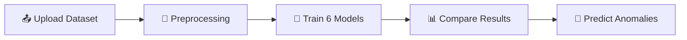

<br><br>

# NetSentinel

### Network Anomaly Detection Using Machine Learning

**Upload data • Train six models • Compare results • Detect threats**

An end-to-end ML platform with a Flask backend and an interactive SOC-style dashboard for classifying network traffic as normal or anomalous.

<br>

[](https://www.python.org/)
[](https://flask.palletsprojects.com/)
[](https://scikit-learn.org/)
[](https://render.com/)

<br>

**[📂 View Source](https://github.com/YAKSHITH684/Network-Anomaly-Detection-Using-ML)** · **[🐞 Report a Bug](https://github.com/YAKSHITH684/Network-Anomaly-Detection-Using-ML/issues)**

</div>

---

## 📑 Table of Contents

- [Overview](#-overview)
- [Features](#-features)
- [How It Works](#-how-it-works)
- [Tech Stack](#️-tech-stack)
- [Project Structure](#️-project-structure)
- [Getting Started](#️-getting-started)
- [Deployment on Render](#️-deployment-on-render)
- [Configuration](#️-configuration)
- [Roadmap](#-roadmap)
- [Contributing](#-contributing)
- [License](#-license)
- [Author](#-author)

---

## 📌 Overview

Network intrusions and abnormal traffic are hard to spot by hand. **NetSentinel** shows how machine learning can support network security analysis: you upload a dataset, the platform preprocesses it, trains and compares multiple classifiers, and lets you run predictions, all from a dark, SOC-themed web dashboard.

It combines a **Flask API** that runs the full ML pipeline with an **interactive frontend** (circuit-grid backdrop, radar sweep, and a live pipeline-rail visualization), and serves as a foundation for future cybersecurity applications.

---

## ✨ Features

| Feature | Description |
|---|---|
| 📤 **Dataset Upload** | Bring your own network traffic dataset through the dashboard |
| 🧹 **Automated Preprocessing** | Data cleaning and preparation handled by the backend pipeline |
| 🤖 **Six-Model Training** | Train six ML classifiers on the same data in one run |
| 📊 **Model Comparison** | Compare model performance side by side to pick the best one |
| 🎯 **Prediction** | Classify new traffic records as normal or anomalous |
| 🖥️ **SOC-Style Dashboard** | Dark theme with circuit-grid backdrop, radar sweep, and pipeline rail |
| ☁️ **One-Click Deploy** | Render Blueprint deploys backend and frontend together |

---

## 🚀 How It Works



The dashboard's pipeline rail mirrors these stages so you can follow progress from upload to prediction.

---

## 🛠️ Tech Stack

| Layer | Technologies |
|---|---|
| **Frontend** | HTML5, CSS3, JavaScript (static site) |
| **Backend** | Python 3.12, Flask, Gunicorn |
| **Machine Learning** | Python ML stack (scikit-learn style pipeline), six classifiers |
| **Hosting** | Render (static site + web service) |

---

## 🗂️ Project Structure

```
Network-Anomaly-Detection-Using-ML/
│
├── Backend/            # Flask API and ML pipeline
│   ├── app.py
│   └── requirements.txt
│
├── Frontend/           # Static dashboard (HTML/CSS/JS)
│   ├── index.html
│   └── dashboard.html
│
├── render.yaml         # Render Blueprint (backend + frontend)
├── start.bat           # Windows helper script for local startup
└── README.md
```

---

## ⚙️ Getting Started

### Prerequisites

- Python 3.12 (recommended)
- Git

### 1. Clone the repository

```bash
git clone https://github.com/YAKSHITH684/Network-Anomaly-Detection-Using-ML.git
cd Network-Anomaly-Detection-Using-ML
```

### 2. Run the backend

```bash
cd Backend
python -m venv venv

# Windows
venv\Scripts\activate
# Linux / macOS
source venv/bin/activate

pip install -r requirements.txt
flask --app app run
```

The API starts at `http://127.0.0.1:5000`. A health check is available at `/api/health`.

### 3. Run the frontend

In a new terminal:

```bash
cd Frontend
python -m http.server 5500
```

Open **http://localhost:5500** in your browser, and point the dashboard at your local backend URL if it isn't picked up automatically.

> 💡 **Windows shortcut:** `start.bat` in the project root is provided to start the app locally.

---

## ☁️ Deployment on Render

The repo ships with a `render.yaml` Blueprint that creates **two services** from one repo:

| Service | Type | Root Dir | Notes |
|---|---|---|---|
| `anomaly-detection-backend` | Web Service (Python) | `Backend` | Runs Gunicorn, health check at `/api/health` |
| `anomaly-detection-frontend` | Static Site | `Frontend` | Backend URL injected at build time |

**Steps**

1. Push the repo to GitHub.
2. In Render: **New + → Blueprint** → connect this repo → **Apply**.
3. Render builds both services and automatically wires the frontend to the backend's live URL, with no manual API URL entry.

Backend start command:

```bash
gunicorn app:app --workers 1 --threads 4 --timeout 120 --bind 0.0.0.0:$PORT
```

---

## 🔧 Configuration

| Variable | Service | Purpose |
|---|---|---|
| `PYTHON_VERSION` | Backend | Python runtime version (`3.12.3`) |
| `SECRET_KEY` | Backend | Flask secret key (auto-generated on Render) |
| `CORS_ORIGINS` | Backend | Allowed origins (set to `*` by default, restrict it in production) |
| `BACKEND_HOST` | Frontend | Auto-filled from the backend service; written into `env.js` at build time |

---

## 🔮 Roadmap

- [ ] 📡 Real-time traffic monitoring
- [ ] 🔔 Alerting for detected anomalies
- [ ] 💾 Model saving and reuse
- [ ] 📈 Richer evaluation charts
- [ ] 🧠 Deep learning models
- [ ] 🔐 User accounts and history

---

## 🤝 Contributing

Contributions are welcome!

1. Fork the repository
2. Create a feature branch: `git checkout -b feature/your-feature`
3. Commit your changes: `git commit -m "Add your feature"`
4. Push to your branch: `git push origin feature/your-feature`
5. Open a Pull Request

---

## 📄 License

No license has been added yet. Add one (e.g. MIT) if you want others to reuse this project.

---

## 👨‍💻 Author

**YAKSHITH684**
GitHub: [@YAKSHITH684](https://github.com/YAKSHITH684)

<div align="center">

Built with Flask, scikit-learn, and Render.

⭐ If you find this project useful, consider giving the repository a star!

</div>
