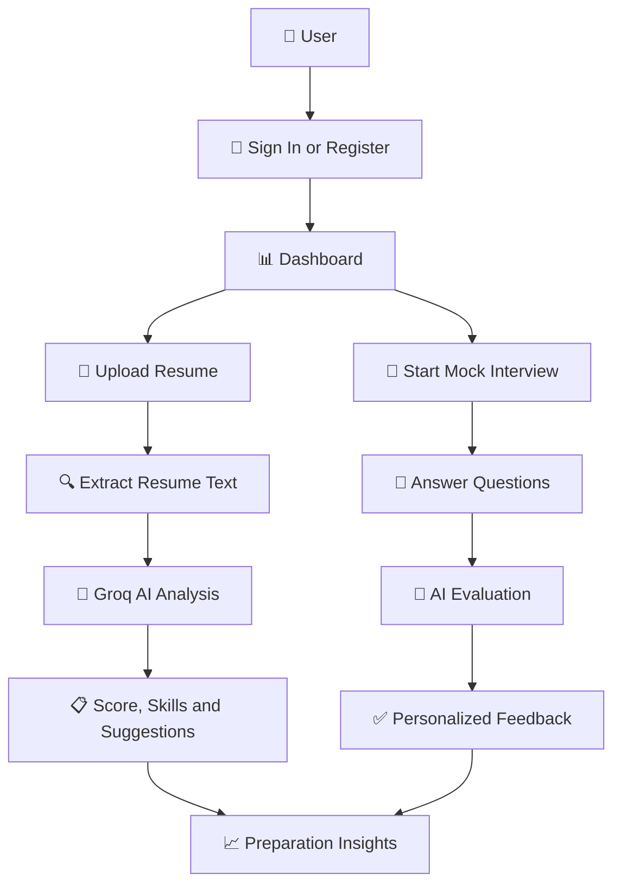

# 🤖 Intervux AI — Your Personal AI Interview Coach

**Prepare Smarter. Practice Better. Get Hired.**

Intervux AI is an AI-powered interview preparation platform that helps students, fresh graduates, and job seekers become interview-ready through intelligent resume analysis, realistic mock interviews, personalized feedback, and career progress tracking.

<p align="center">
  <a href="https://intervux-ai-10.onrender.com/01_login.html"><strong>🚀 Try Live App</strong></a>
  &nbsp; • &nbsp;
  <a href="https://github.com/YAKSHITH684/Intervux-AI"><strong>📂 GitHub Repository</strong></a>
  &nbsp; • &nbsp;
  <a href="https://github.com/YAKSHITH684/Intervux-AI/issues"><strong>🐞 Report a Bug</strong></a>
</p>

<p align="center">
  
  
  
  
  
  
</p>

---

## 📑 Table of Contents

- [Live Demo](#-live-demo)
- [Overview](#-overview)
- [Problem Statement](#-problem-statement)
- [Our Solution](#-our-solution)
- [Key Features](#-key-features)
- [How It Works](#-how-it-works)
- [AI Integration](#-ai-integration)
- [Technology Stack](#️-technology-stack)
- [Project Structure](#️-project-structure)
- [Getting Started](#️-getting-started)
- [API Reference](#-api-reference)
- [Deployment](#️-deployment)
- [Project Highlights](#-project-highlights)
- [Future Enhancements](#-future-enhancements)
- [Contributing](#-contributing)
- [License](#-license)
- [Author](#-author)

---

## 🌐 Live Demo

| Resource | Link |
|---|---|
| 🚀 Live Application | [Launch Intervux AI](https://intervux-ai-10.onrender.com/) |
| 🔑 Login Page | [Open Login](https://intervux-ai-10.onrender.com/01_login.html) |
| 💻 Source Code | [GitHub Repository](https://github.com/YAKSHITH684/Intervux-AI) |
| 🐛 Bug Reports | [Create an Issue](https://github.com/YAKSHITH684/Intervux-AI/issues) |

> **Note:** The hosted application may take a short time to respond after a period of inactivity.

---

## 📌 Overview

Interview preparation requires more than memorizing answers. Candidates need a strong resume, realistic practice, constructive feedback, and a clear understanding of their strengths and weaknesses.

**Intervux AI brings these preparation tools together in one platform.**

Users can upload their resumes, receive AI-generated insights, practice interviews across multiple categories, evaluate their answers, and monitor their preparation progress.

The platform uses Python, FastAPI, SQLite, and the Groq API to provide an interactive interview preparation experience.

## 🎯 Problem Statement

Students and job seekers often face the following challenges:

- Limited access to realistic mock interviews.
- Difficulty identifying resume weaknesses and missing skills.
- Lack of personalized feedback on interview answers.
- Limited opportunities to practice technical concepts and problem-solving.
- Difficulty tracking interview readiness and improvement.

## 💡 Our Solution

Intervux AI acts as a personal AI-powered interview coach.

| Candidate Need | Intervux AI Solution |
|---|---|
| Improve resume quality | AI-assisted resume analysis and ATS-oriented scoring |
| Practice interviews | Interactive mock interviews and follow-up questions |
| Identify weaknesses | Personalized feedback and improvement suggestions |
| Prepare for different roles | Technical, HR, System Design, and DSA modes |
| Track preparation | Progress and readiness dashboard |
| Get career guidance | AI career assistant |

---

## ✨ Key Features

### 📄 1. Intelligent Resume Analysis

- Upload resumes in PDF, DOCX, or TXT format.
- Generate an AI-assisted ATS compatibility score.
- Identify skills, strengths, and potential gaps.
- Receive actionable resume improvement suggestions.

### 🎤 2. AI-Powered Mock Interviews

Practice across four interview categories:

- **Technical:** Programming concepts and technical questions.
- **HR:** Behavioral questions and communication.
- **System Design:** Architecture and design discussions.
- **DSA:** Data structures, algorithms, and problem-solving.

### 🎯 3. Smart Practice Mode

- Generate topic-based questions.
- Submit answers for AI evaluation.
- Receive personalized feedback.
- Identify areas that need improvement.

### 📊 4. Career Progress Dashboard

- View interview preparation progress.
- Review strengths and areas for improvement.
- Monitor readiness indicators.
- Plan future practice sessions.

### 💬 5. AI Career Assistant

Get guidance on interview preparation, resume improvement, technical learning, and career development.

### 🔐 6. User Authentication

- User registration and login.
- Account access management.
- Password recovery functionality.

---

## 🚀 How It Works



### Resume Analysis Workflow

**Upload Resume → Extract Text → Analyze with AI → Generate Insights**

1. Upload a supported resume file.
2. Extract text from the document.
3. Process the extracted content using the AI integration.
4. Display the score, skills, strengths, and suggestions.

### Interview Practice Workflow

**Select Interview Mode → Answer Questions → Evaluate Responses → Receive Feedback**

1. Select an interview category.
2. Generate relevant questions.
3. Submit answers.
4. Receive AI-generated evaluation and improvement guidance.

---

## 🧠 AI Integration

Intervux AI integrates with the Groq API to support resume analysis, interview simulation, and career assistance.

| Component | Details |
|---|---|
| AI Provider | [Groq](https://groq.com/) |
| Configured Model | Llama 3.3 70B Versatile |
| Integration | Groq API |
| Primary Language | Python |
| Backend Framework | FastAPI |

### AI-Powered Capabilities

**Resume Intelligence**
- Resume content analysis.
- Skill extraction.
- ATS-oriented scoring.
- Improvement recommendations.

**Interview Intelligence**
- Question generation.
- Contextual follow-up questions.
- Answer evaluation.
- Personalized feedback.

**Career Assistance**
- Interview preparation strategies.
- Resume advice.
- Career guidance and learning recommendations.

> AI-generated scores and feedback support interview preparation. They are not official ATS results or guarantees of interview success.

---

## 🛠️ Technology Stack

| Layer | Technologies |
|---|---|
| Frontend | HTML5, CSS3, JavaScript |
| Backend | Python, FastAPI |
| API Architecture | REST APIs |
| Database | SQLite |
| ORM | SQLAlchemy |
| AI Integration | Groq API, Llama 3.3 70B Versatile |
| Document Processing | pdfplumber, python-docx |
| Hosting | Render |
| Version Control | Git, GitHub |

---

## 🗂️ Project Structure

```text
Intervux-AI/
│
├── Frontend/
│   ├── 01_login.html
│   ├── register.html
│   ├── dashboard.html
│   ├── resume.html
│   ├── ai_analysis.html
│   ├── interview.html
│   ├── practice.html
│   ├── progress.html
│   ├── resources.html
│   ├── style.css
│   └── script.js
│
└── Backend/
    ├── app.py
    ├── routes.py
    ├── requirements.txt
    └── database/
        ├── database.py
        └── models.py
```

---

## ⚙️ Getting Started

Follow these steps to run Intervux AI locally.

### Prerequisites

- Python 3.x
- Git
- A modern web browser
- A Groq API key from the [Groq Console](https://console.groq.com/)

### 1. Clone the Repository

```bash
git clone https://github.com/YAKSHITH684/Intervux-AI.git
cd Intervux-AI
```

### 2. Set Up the Backend

```bash
cd Backend
python -m venv venv
```

Activate the virtual environment.

**Windows — Command Prompt**

```bat
venv\Scripts\activate
```

**Windows — PowerShell**

```powershell
.\venv\Scripts\Activate.ps1
```

**Linux / macOS**

```bash
source venv/bin/activate
```

Install the dependencies:

```bash
pip install -r requirements.txt
```

### 3. Configure Environment Variables

Set your Groq API key.

**Windows — Command Prompt**

```bat
set GROQ_API_KEY=your_groq_api_key_here
```

**Windows — PowerShell**

```powershell
$env:GROQ_API_KEY="your_groq_api_key_here"
```

**Linux / macOS**

```bash
export GROQ_API_KEY="your_groq_api_key_here"
```

Replace the placeholder with your actual API key. Never commit API keys or secrets to GitHub.

### 4. Start the Backend

From the `Backend` directory, run:

```bash
uvicorn app:app --reload
```

The backend should be available at:

- API: `http://127.0.0.1:8000`
- Interactive API documentation: `http://127.0.0.1:8000/docs`

### 5. Start the Frontend

Open a second terminal and navigate to the frontend directory from the repository root:

```bash
cd Frontend
python -m http.server 5500
```

Open the application:

[http://localhost:5500/01_login.html](http://localhost:5500/01_login.html)

**Troubleshooting:** If the frontend cannot communicate with the backend, verify the API base URL, CORS configuration, and frontend settings.

---

## 📡 API Reference

| Endpoint | Purpose |
|---|---|
| `/register` | User registration |
| `/login` | User authentication |
| `/forgot-password` | Password recovery |
| `/analyze-resume` | Resume analysis |
| `/ai-analysis` | Resume insights |
| `/chat` | AI interview conversation |
| `/assistant` | AI career assistant |
| `/practice/questions` | Practice question generation |
| `/practice/feedback` | Practice answer evaluation |

For request and response schemas, start the backend and visit:

**[FastAPI Interactive Documentation](http://127.0.0.1:8000/docs)**

Verify endpoint names against the current backend implementation.

---

## ☁️ Deployment

Intervux AI is hosted on Render.

| Item | Details |
|---|---|
| Hosting Platform | Render |
| Live Application | [Open Intervux AI](https://intervux-ai-10.onrender.com/) |
| Login Page | [Open Login Page](https://intervux-ai-10.onrender.com/01_login.html) |
| Source Code | [GitHub Repository](https://github.com/YAKSHITH684/Intervux-AI) |

Configure API keys securely through the hosting dashboard and ensure the production database and application settings are configured appropriately.

---

## 📊 Project Highlights

| Category | Details |
|---|---|
| Project Type | AI-powered web application |
| Frontend | HTML, CSS, JavaScript |
| Backend | Python, FastAPI |
| Database | SQLite |
| AI Integration | Groq API |
| Interview Modes | 4 |
| Resume Formats | PDF, DOCX, TXT |
| API Style | REST |
| Deployment | Render |

---

## 🔮 Future Enhancements

- [ ] 🎙️ Voice-based mock interviews.
- [ ] 🎥 Video interview analysis.
- [ ] 📈 Interview history and performance analytics.
- [ ] 📄 AI-powered resume builder.
- [ ] 🏢 Company-specific interview preparation.
- [ ] 🏆 Candidate leaderboard and practice challenges.
- [ ] 📱 Mobile application.
- [ ] 📧 Personalized practice reminders.

Have a feature idea? [Open a GitHub issue](https://github.com/YAKSHITH684/Intervux-AI/issues).

---

## 🤝 Contributing

Contributions, suggestions, and bug reports are welcome.

1. Fork the repository.
2. Create a feature branch:

   ```bash
   git checkout -b feature/your-feature
   ```

3. Commit your changes:

   ```bash
   git commit -m "Add your feature"
   ```

4. Push your branch:

   ```bash
   git push origin feature/your-feature
   ```

5. Open a pull request describing your changes.

For major changes, open an issue first to discuss the proposed improvements.

---

## 📄 License

No license is currently specified for this repository. Until a license is added, others should not assume they have permission to reuse, modify, or redistribute the code.

If you intend to make the project open source, consider adding an appropriate license, such as the MIT License.

---

## 👨‍💻 Author

**Yakshith Anandapu**

- GitHub: [@YAKSHITH684](https://github.com/YAKSHITH684)
- Project Repository: [Intervux AI](https://github.com/YAKSHITH684/Intervux-AI)
- Live Application: [Try Intervux AI](https://intervux-ai-10.onrender.com/)

---

<p align="center">
  <strong>Built with ❤️ using Python, FastAPI, JavaScript, SQLite, and Groq AI.</strong>
  <br><br>
  ⭐ If you find Intervux AI useful, consider giving the repository a star!
</p>

By combining Machine Learning algorithms, a Flask backend, and an interactive web dashboard, the project demonstrates how data-driven classification can support network security analysis and serve as a foundation for future cybersecurity applications.

If you find this project useful, consider giving the repository a ⭐ on GitHub!

